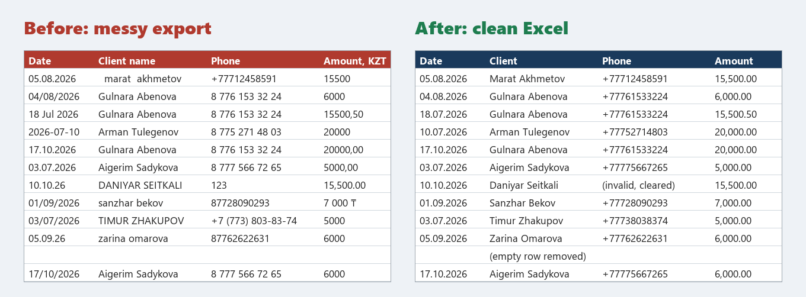
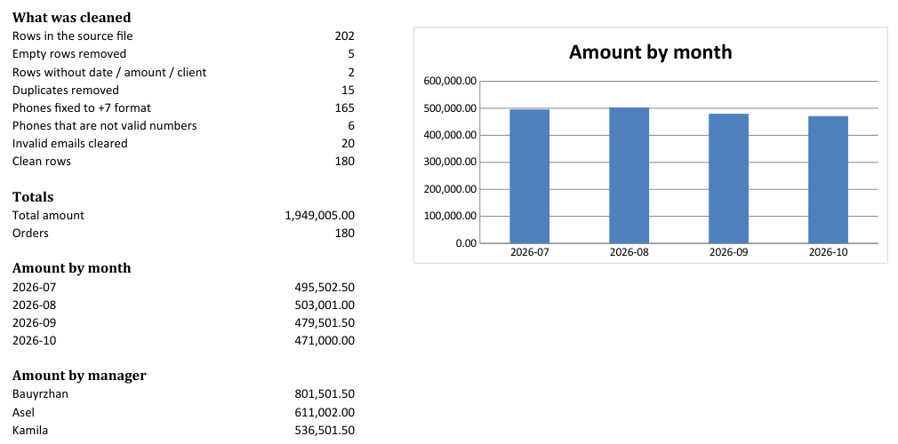

# Excel Data Cleanup

**Messy export in, clean Excel report out: fixed dates, phones, names and amounts, no duplicates, totals and a chart.**

[](https://github.com/zhangir777/excel-data-cleanup/actions/workflows/ci.yml)

**Hire me:** [Upwork](https://www.upwork.com/freelancers/~012c68804f9b4d4550) · [Fiverr](https://www.fiverr.com/akhmetov_zhangi) · [Telegram @ZhangirAkhmetov](https://t.me/ZhangirAkhmetov)



*The same 12 rows from [`samples/messy_sales.csv`](samples/messy_sales.csv) before and after cleaning. All names and numbers are made up.*

## What gets fixed

| Problem in the export | Result |
|---|---|
| Dates as `05.08.2026`, `04/08/2026`, `18 Jul 2026`, `2026-07-10`, `10.10.26` | real Excel dates, `DD.MM.YYYY` |
| Amounts as `7 000 ₸`, `15500,50`, `15,500.00` | numbers you can sum, `#,##0.00` |
| Phones as `8 776 153 32 24`, `+7 (773) 803-83-74` | `+77761533224`; invalid ones cleared and counted |
| `  marat  akhmetov`, `DANIYAR SEITKALI` | `Marat Akhmetov`, `Daniyar Seitkali` |
| Headers `Date `, `Client name`, `Amount, KZT`, `Дата`, `Сумма` | mapped to one set of columns |
| Double exports, empty lines, rows without a date or amount | removed, each one listed with the reason |

## The report

One `.xlsx` with three sheets:
- **Summary**: what was cleaned, total amount, amount by month (with a chart) and by manager. Prints on one page.
- **Clean data**: styled header, frozen first row, filters, date and number formats.
- **Removed rows**: every dropped row with the reason, so nothing disappears silently.



Sample run: 202 rows in → 5 empty, 2 broken, 15 duplicates removed → **180 clean rows**, 165 phones fixed.
Result: [`samples/clean_sales.xlsx`](samples/clean_sales.xlsx)

## Working with me

Send me your file (or a sample of it) and tell me what the result should look like.
**Timeline:** 1–2 days. **Price:** from $30. If you get the same export every week, I leave you the script so you can re-run it with one command.

---

## Technical

Python 3.12+, openpyxl, no other runtime dependencies.

```bash
uv sync
uv run clean-table samples/messy_sales.csv --out out/clean.xlsx
uv run clean-table export.xlsx --month-first     # US dates: 02/03/2026 = Feb 3
uv run pytest -q                                 # 24 tests
uv run python scripts/make_sample.py             # regenerate the made-up sample
```

| Path | What |
|---|---|
| `cleanup/clean.py` | parsing and cleaning rules, no Excel code |
| `cleanup/report.py` | the Excel report (sheets, formats, chart) |
| `cleanup/cli.py` | reads CSV (`,` `;` or tab) or the first sheet of `.xlsx` |

Adapting to a client: add their header names to `ALIASES` in `cleanup/clean.py`, adjust the columns, done.

## На русском

Чищу грязные выгрузки из CRM, Kaspi, 1С, Google Форм: даты, суммы, телефоны (+7), имена, дубли, пустые строки. На выходе Excel со сводкой, графиком по месяцам и листом с удалёнными строками и причинами. Срок 1–2 дня, от $30. Скрипт остаётся у вас для еженедельных выгрузок.
